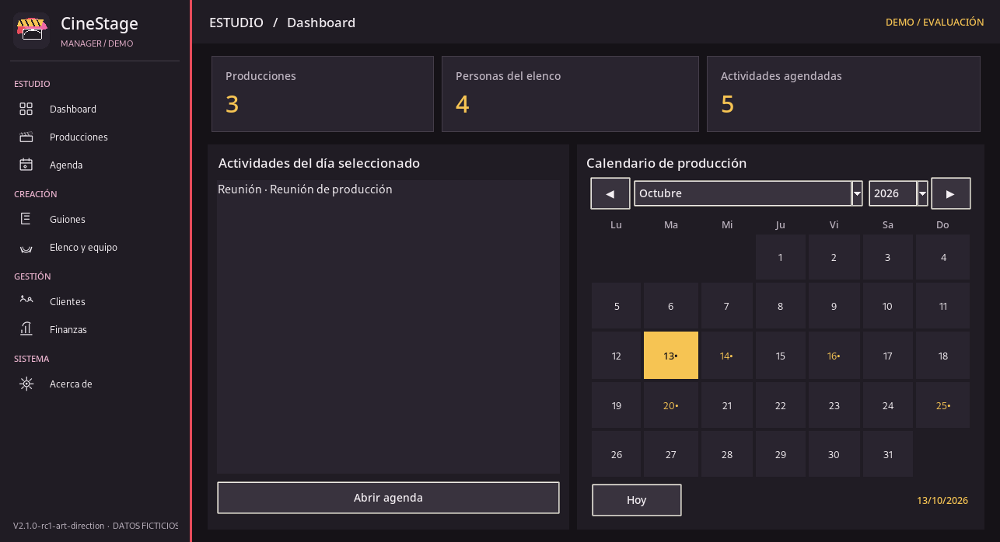
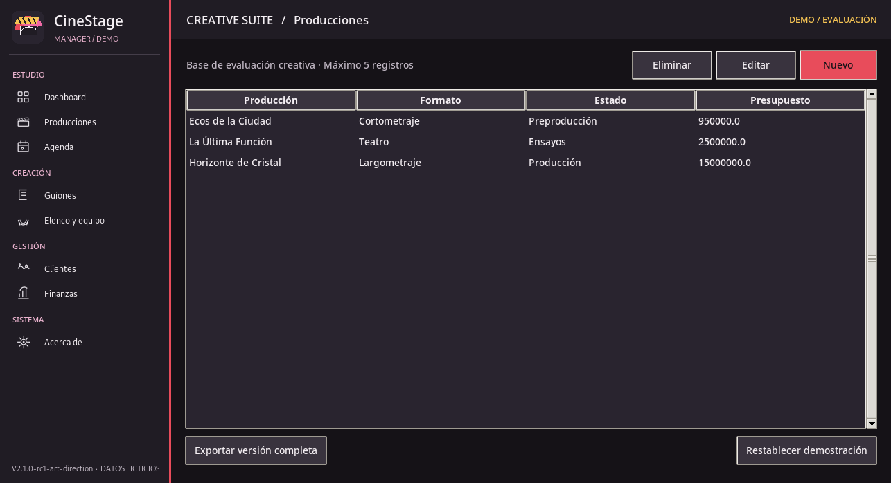
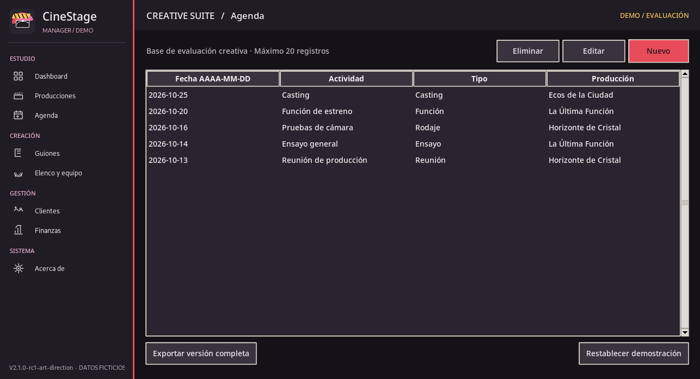

# CineStage Manager — DEMO 🎬

**Creative Production Suite for Film & Theatre**  
**Version:** `2.1.0-rc1` · **Platform:** Windows desktop · **Language:** Spanish

CineStage Manager is a desktop application concept for organizing film, theatre, and audiovisual productions. This public DEMO provides an independent evaluation environment with sample data and a visual design aligned with the private FULL edition.

> **Evaluation build:** this is a release candidate, not a final commercial release. The DEMO is intentionally limited and does not include the private FULL application.

## Preview

| Productions | Creative calendar |
| --- | --- |
|  |  |

[View the DEMO information screen](screenshots/04_Acerca_de.png)

## What you can try

- Dashboard with project and activity indicators.
- Interactive monthly production calendar.
- Sample productions, clients, and collaborators.
- Basic script records and cast/team information.
- Scheduling and example financial records.
- Create, edit, and delete records within the DEMO limits.
- Reset the sample environment.

The demo uses **fictional data**. Its SQLite database is stored separately from the private FULL edition.

## DEMO vs. FULL

| Capability | Public DEMO | Private FULL |
| --- | --- | --- |
| Creative interface and dashboard | Yes | Yes |
| Interactive calendar | Yes | Yes |
| Productions, clients, cast and agenda | Limited examples | Extended management |
| Script management | Basic records | Full script editor |
| Multimedia and theatre seating | Not included | Included |
| PDF, DOCX and XLSX exports | Not included | Included |
| Private project database and backups | Not included | Included |

The FULL edition is developed and maintained separately. Its source code and private data are **not distributed here**.

## Running locally on Windows

**Requirements:** Python 3.11 or newer with Tkinter support.

1. Download or clone the repository.
2. Run `INSTALAR_DEMO.bat` to initialize the DEMO and optionally create a shortcut.
3. Start the application with `run_demo_windows.bat`.
4. If startup fails, use `run_demo_debug_windows.bat`.

Alternative from a terminal in the repository root:

`python demo_launcher.py`

The DEMO works locally, without an online account. The example database is generated in your user Documents directory under `CineStageManager_DEMO`.

**Note:** Windows installation and packaging require validation on the target computer. This repository does not contain a precompiled Windows `.exe`.

## Technology

- Python
- Tkinter / ttk
- SQLite
- Custom creative UI components

## Screenshots and documentation

- [More screenshots](screenshots/)
- [DEMO details and limitations](README_DEMO.md)
- [Version information](VERSION.txt)
- [Third-party notices](THIRD_PARTY_NOTICES.txt)

## Licensing and evaluation

This repository is provided for evaluation and portfolio demonstration. See [`LICENSE_DEMO.txt`](LICENSE_DEMO.txt). The current license text is a **draft** and should be reviewed before commercial distribution. No license to the private FULL edition is granted.

---

**Project portfolio:** [carlos-adrian-ledesma](https://github.com/carlos-adrian-ledesma)
